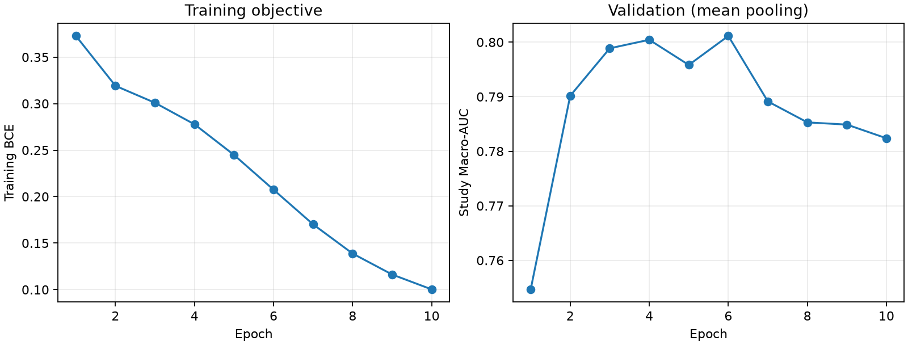
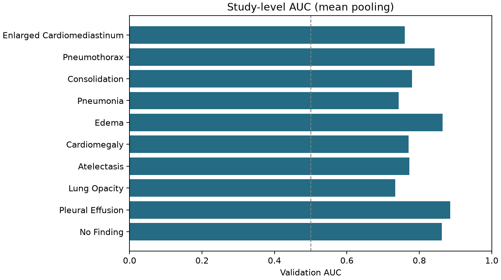

# 首轮实验结果

生成时间：2026-10-15T21:55:58+08:00。

模型：convnext_tiny；输入尺寸：320；最佳轮：6。
训练状态：early_stopped。仅使用官方 train 训练，valid 用于模型与聚合选择。

Study 验证 Macro-AUC：**0.801159**；Macro-F1（0.5）：0.355964。
聚合方式：mean；859 次检查、228 位患者。
验证分数已经参与选模，不代表独立测试成绩，也不能据此推断官方排名。

| 类别 | 验证正例检查数 | AUC | F1（0.5） |
|---|---:|---:|---:|
| 1 Enlarged Cardiomediastinum | 24 | 0.759506 | 0.000000 |
| 2 Pneumothorax | 37 | 0.841685 | 0.208333 |
| 3 Consolidation | 46 | 0.780162 | 0.074074 |
| 4 Pneumonia | 68 | 0.742945 | 0.126582 |
| 5 Edema | 115 | 0.864522 | 0.491803 |
| 6 Cardiomegaly | 177 | 0.769869 | 0.410714 |
| 7 Atelectasis | 193 | 0.772382 | 0.460274 |
| 8 Lung Opacity | 214 | 0.733703 | 0.342508 |
| 9 Pleural Effusion | 260 | 0.885071 | 0.709434 |
| 10 No Finding | 306 | 0.861740 | 0.735915 |

## 聚合对照

| 聚合 | Macro-AUC |
|---|---:|
| mean | 0.801142 |
| max | 0.793568 |
| mean_max | 0.798152 |

mean 聚合的患者 bootstrap 95% 描述区间：[0.761219, 0.839636]。
该区间未校正反复调参/模型选择；不是 selected pooling 的独立置信区间。

## 本机部署检查

推理权重：106.22 MiB；batch=1 端到端中位数 32.85 ms，P95 40.27 ms。
计入原始 JPG 读取/解码、预处理、GPU 推理和概率回传；不含冷启动。该结果来自本机，尚未在官方 T4 验收。

## 提交

`submission.csv` 为完整概率长表，应有 14,140 行；另一份文件按 0.5 阈值过滤。
官方缺失类别概率和 F1 阈值约定仍待确认，当前文件不能宣称已经通过官方评分。

